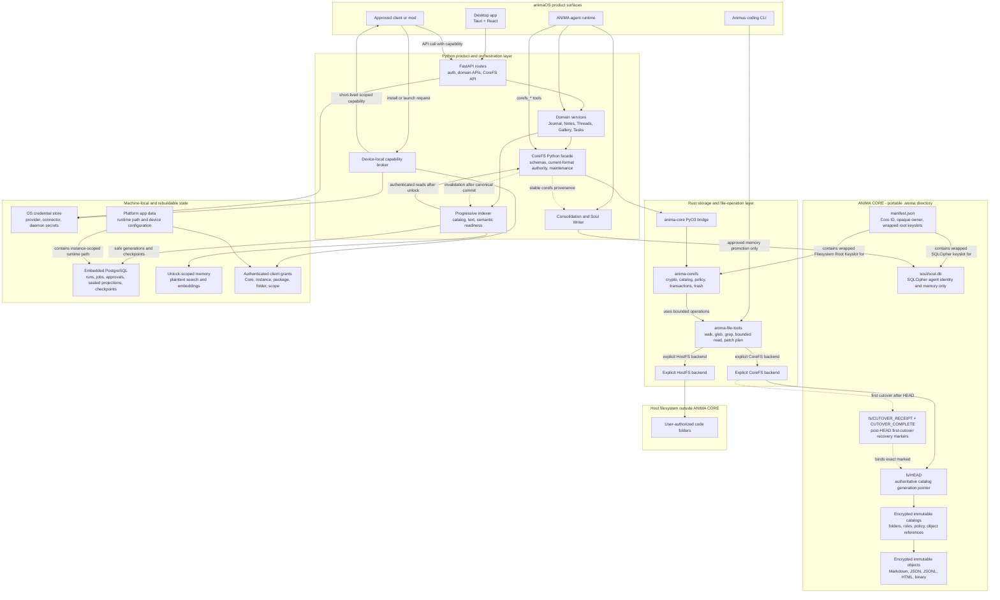
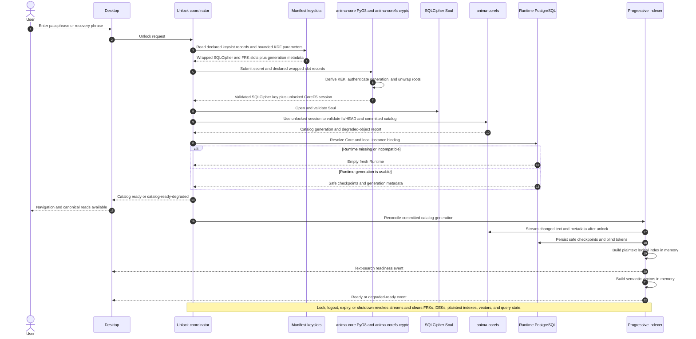
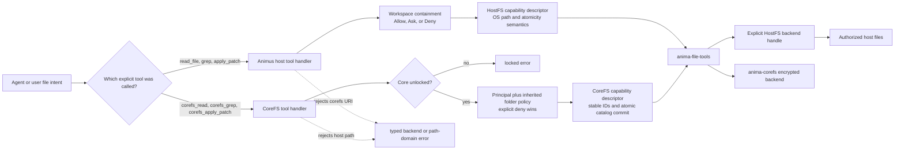
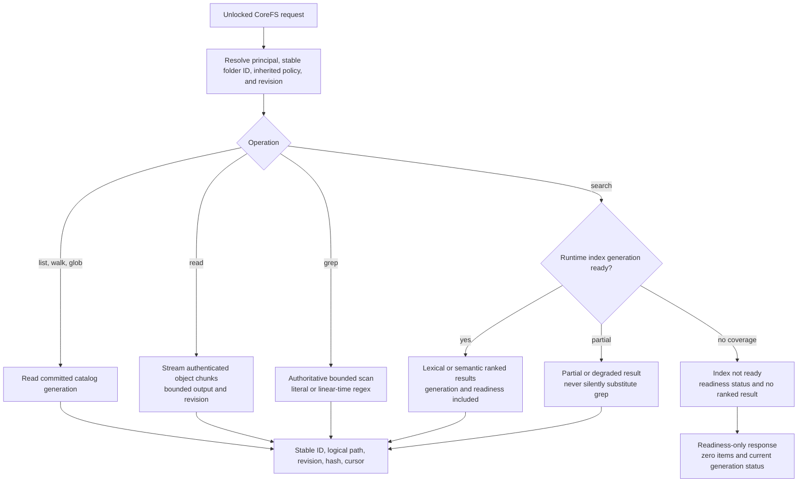
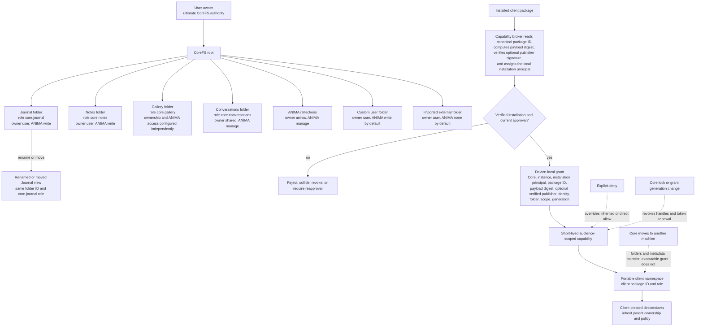
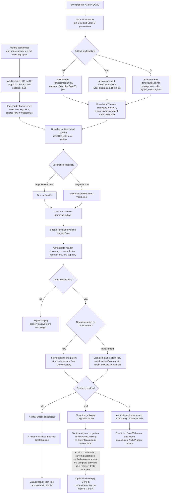

# ANIMA CORE Filesystem Architecture

> **Current-format architecture.** The approved greenfield release initializes Soul and CoreFS directly. Pre-release storage layouts and archive formats have no supported migration path. Supported encrypted Souls can receive verified schema upgrades; local validation does not establish signed Windows/macOS/Linux package readiness.

**Normative sources:** [Portable Core Filesystem design](../../superpowers/specs/2026-07-12-portable-core-filesystem-design.md), [key hierarchy design](../../superpowers/specs/2026-07-12-portable-core-key-hierarchy-design.md), and [implementation plan](../../superpowers/plans/2026-07-12-portable-core-filesystem.md).

## 1. Complete System Topology

animaOS is the product. ANIMA CORE is the portable encrypted Soul-plus-CoreFS subsystem. Runtime PostgreSQL, installed-client grants, device configuration, and external credentials remain machine-local.



There is deliberately no CoreFS-to-host-files edge and no Runtime-to-canonical-catalog write edge. CoreFS cannot escape into an Animus folder, and Runtime cannot become canonical authority.

### Authority summary

| State | Canonical authority | Portable | Rebuildable |
|---|---|---:|---:|
| ANIMA identity, durable memories, self-model, relationship, growth | SQLCipher Soul | yes | no |
| Diary, notes, folders, threads, messages, gallery, attachments, tasks, portable preferences | encrypted CoreFS catalogs and objects | yes | no |
| Runs, jobs, queues, checkpoints, blind tokens, safe operational metadata | Runtime PostgreSQL | no | yes |
| Decrypted text index and semantic vectors | unlock-scoped process memory | no | yes |
| Client executable grants and machine configuration | authenticated platform app data | no | yes or reapproved |
| Provider, connector, and daemon secrets | OS credential store | no | reconfigured |

### Implemented domain and route authority

| Product surface | Canonical authority | Runtime role |
|---|---|---|
| `/api/auth`, account/profile, onboarding | manifest keyslots → SQLCipher Soul unlock → encrypted CoreFS account profile | session/index binding only |
| `/api/threads`, `/api/chat`, visible edit/delete | CoreFS thread objects and immutable message events | runs, steps, approvals, null-body CoreFS references |
| `/api/diary`, notes/folders/drafts | CoreFS writing objects, stable roles, attachments, encrypted trash | no retained content authority |
| gallery, avatar, chat images | bounded CoreFS binary objects plus canonical content links | rebuildable annotations/embeddings only |
| documents, sources, OKF | CoreFS originals plus normalized/canonical source bodies | parsing, spans, compiler/search projections |
| `/api/tasks`, portable preferences/presence | CoreFS optimistic JSON mutations | no retained app-row authority |
| memory, claims, episodes, self-model | SQLCipher Soul through the Soul Writer/consolidation boundary | candidates, promotion journal, retrieval caches |
| `/api/corefs/transfer` | pinned Soul/CoreFS snapshot and authenticated V2 archive | operation progress only; paths/passphrases excluded |

`SoulOwner` retains the local numeric owner ID and opaque Core owner UUID. Private account fields live in the encrypted CoreFS profile. App tables and disposable vector columns are retired from supported Soul schemas; content routes cannot fall back to them. A valid Soul-only restore unlocks with an unavailable profile and `filesystem_missing` recovery state.

## 2. Unlock, Startup, and Progressive Reindexing

The Core becomes navigable before full-text and semantic indexing complete. A missing Runtime is a rebuild event, not data loss.



### Current-format bootstrap and supported Soul schema retirement

Registration durably wraps pending Soul/Filesystem roots before writing encrypted content. Interrupted registration resumes with those authenticated roots; it cannot silently generate different keys over an existing Soul.

An existing supported Soul at revision `20260812_0001` upgrades to `20261009_0001` only after manifest credentials authenticate its owner and an independently reopened SQLCipher original verifies table hashes and counts. The encrypted original is retained in a sibling `<Core-name>.schema-recovery` directory outside the active Core. The new Soul records an opaque archive receipt, not a host path.

The forward revision replaces account mappings with `SoulOwner`, rebuilds retained ownership FKs, removes app tables and disposable vectors, and validates retained records plus `PRAGMA foreign_key_check`. Authenticated CoreFS source identities become stable Core URIs. Unavailable historical sources retain their original IDs with explicit `source_unavailable` provenance; numeric Runtime IDs never establish CoreFS authority.

A supported Soul without CoreFS remains unlockable. Its original encrypted app bytes are preserved in the verified recovery copy, while the active schema contains only Soul records and a missing-source receipt. No pre-release importer or legacy content service is enabled.

## 3. Explicit HostFS and CoreFS Tool Routing

The shared library reuses algorithms, not authority. Tool names and backend handles select the boundary explicitly; a path string never causes automatic routing.



## 4. Read, Grep, Search, and Atomic Mutation

### Read and discovery paths



### One-generation write and patch transaction

```mermaid
sequenceDiagram
    autonumber
    participant Caller
    participant Tools as anima-file-tools
    participant Core as anima-corefs
    participant Lock as Core-wide commit lock
    participant Store as Objects, catalogs, fs/HEAD, and cutover markers
    participant Index as Runtime indexer

    Caller->>Tools: write or multi-file apply_patch with expected revisions
    Tools->>Tools: Parse into typed mutation plan
    Tools->>Core: Submit complete plan
    Core->>Core: Resolve every stable ID and path
    Core->>Core: Preflight policy, deny rules, revisions, collisions, formats, and limits
    Core->>Core: Prepare encrypted immutable object revisions
    Core->>Store: Flush and atomically publish immutable object revisions
    Core->>Lock: Acquire exclusive commit lock
    Core->>Store: Reload authoritative generation
    Store-->>Core: Latest catalog and fs/HEAD
    Core->>Core: Revalidate every precondition

    alt Any precondition changed or failed
        Core->>Lock: Release lock
        Core-->>Caller: Structured conflict with unreferenced object garbage and no catalog generation
    else Complete plan remains valid
        Core->>Store: Publish encrypted catalog generation
        Core->>Store: Atomically replace and flush fs/HEAD
        opt First accepted post-migration mutation
            Core->>Store: Publish exact CUTOVER_RECEIPT then CUTOVER_COMPLETE
            Note over Core,Store: HEAD is already authoritative; marker failure returns recovery pending.
        end
        Core->>Lock: Release lock
        Core-->>Index: Invalidate committed generation
        Note over Core,Index: Index failure never rolls back the canonical commit.
        Core-->>Caller: New revisions, hashes, generation, atomic true
    end
```

### Catalog-bound key rotation

FRK activation is split deliberately across the credential coordinator and CoreFS. The credential side must first durably write and independently verify both pending password and recovery keyslots. Only then may it pass session-owned old/pending FRK subkeys into the CoreFS rotation transaction; CoreFS never persists those raw keys and does not promote manifest state itself.

```mermaid
sequenceDiagram
    autonumber
    participant Auth as Credential coordinator
    participant Core as anima-corefs
    participant Lock as Core-wide commit lock
    participant Store as Catalogs and fs/HEAD
    participant Runtime as Runtime indexer

    Auth->>Auth: Reload and verify pending password + recovery FRK slots
    Auth->>Core: Old/pending in-memory keyring + expected generation
    Core->>Lock: Acquire exclusive commit lock
    Core->>Store: Reload and authenticate HEAD/catalog with declared FRK version
    Core->>Core: Rewrap every retained Object DEK, including tombstones, under pending OKWK
    Note over Core: Object ciphertext, revision, hash, and key epoch stay unchanged
    Core->>Store: Publish complete encrypted catalog under pending FRK
    Core->>Store: Atomically replace and flush fs/HEAD with pending FRK version
    Core->>Lock: Release lock
    Core-->>Runtime: Invalidate committed generation
    Core-->>Auth: Published generation and required FRK version
    Auth->>Auth: Promote pending FRK; retain prior FRK decrypt-only
```

`fs/HEAD.requiredFrkVersion` is only a key-selection hint until the referenced encrypted catalog authenticates. During activation, a versioned in-memory keyring authenticates the new HEAD/catalog and the older immutable cutover markers with their own keys. After an old cutover key is legitimately retired, a strictly later authenticated catalog carrying the irreversible cutover marker preserves lineage; equal-generation or rollback-only inputs still require the old key and fail closed.

Targeted Object-DEK rotation is separate from FRK rewrap: it streams the authenticated current envelope into a complete new revision with a fresh Object DEK, fresh nonces, and incremented object-key epoch, then uses the normal prepared-revision/catalog commit path. A crash during FRK publication leaves the old HEAD authoritative or the complete pending-key HEAD readable—never a partially visible catalog generation.

Old-key retirement is not implied by successful activation. Authenticated retention inventory must show that no retained catalog HEAD or wrapped Object DEK still requires the retiring version, and a verified backup under the active version must exist. Physical catalog/object pruning and keyslot deletion remain the separately authenticated PCF-010 operation.

## 5. Folder Ownership, ANIMA Access, and Client Trust

Folder names and paths may change. Stable IDs and roles preserve app bindings; policy inheritance controls principals.



| Scope | Read | Create/edit | Rename/move/trash/restore | Policy/grants/reserved roles | Permanent purge/key retirement |
|---|---:|---:|---:|---:|---:|
| User after unlock | yes | yes | yes | yes | recent reauthentication and bound confirmation |
| ANIMA `none` | no | no | no | never | never |
| ANIMA `read` | yes | no | no | never | never |
| ANIMA `write` | yes | yes | no | never | never |
| ANIMA `manage` | yes | yes | yes | never | never |
| Client `read`/`write`/`manage` | by approved scope | by approved scope | `manage` only | never | never |

Normal deletion moves content into encrypted trash. `purge(trash_id, expected_trash_revision, confirmation)` is a separate user-only maintenance operation for already-trashed content after recent reauthentication; ANIMA and clients cannot call it even with `manage`.

## 6. Local Export, Transfer, Recovery, and Runtime Rebuild

One versioned streaming container supports complete, Soul-only, and CoreFS-only local artifacts. Cloud upload and sync remain out of scope.

The V2 exporter pins one coherent Soul/CoreFS snapshot, streams at most 8 MiB per source/ciphertext buffer, and excludes Runtime, device state, grants, credentials, and host paths. A destination probe chooses a verified single file or an authenticated controller-last multipart set. Import never activates directly: full restore and retained-Core rollback create authenticated restart intents consumed before Core locks, databases, or Runtime start. Legacy JSON and `ANMA` V1 archives are unsupported.



Whole-account deletion follows the same restart-only principle. The live API validates the canonical owner and complete active/retained Cores, records an authenticated intent, and revokes unlock sessions without deleting storage. Pre-resource startup requires the exact Runtime binding to be stopped, journals each active-Core/retained-Core/Runtime quarantine and removal boundary, retires registry pointers and credentials, then creates a new empty Core. It never recursively targets a broad home/workspace path and never deletes a running Runtime.

A current-generation archive is self-contained: its HEAD, receipt, completion, and validation pointers all name the same captured authenticated current catalog with the existing cutover epoch. Export freezes those pointer bytes together and rejects a changed checkpoint. Live Core pointers remain untouched. Restoring a rotated Core therefore opens its current content without requiring historical catalogs omitted from the current-generation archive.

## 7. Restore History and Local Maintenance

Security settings expose owner-only inventory, history pruning, explicit trash purge, checkpoint refresh, and decrypt-only FRK retirement through `/api/corefs/maintenance`. ANIMA and installed clients cannot authorize these actions.

The default restore window is 30 days. Live entries and current encrypted trash never expire automatically. Authenticated operation/preparation references pin their catalogs, objects, and key versions. Catalogs without authenticated age metadata receive a conservative authenticated first-observed time rather than a filesystem modification time. Corrupt, unavailable, or incomplete reference sources block destructive maintenance.

Inventory bounds are 100,000 catalog files and 200,000 object files. Each catalog is limited to 16 MiB; aggregate authenticated work is bounded at 128 GiB of catalog bytes and 500 million decoded entries. Runtime journals are limited to 128 MiB and the authenticated first-observed registry to 64 MiB. Exceeding a bound blocks maintenance without deletion. Historical catalog visits and object-body authentication stream through bounded buffers; inventory keeps only the current decoded catalog in memory.

Completed preparation archives become eligible only after their terminal receipts, final snapshots, published catalog coverage, and conservative retention age verify. Incomplete or quarantined preparations keep their references pinned. Quarantine moves whole preparation directories before bounded leaf sweeps so interruption cannot make incomplete metadata appear safe.

Preparation requires the current passphrase and recovery phrase, a verified full backup outside the active Core matching its generation and owner, and a one-use confirmation bound to the exact inventory and action. Confirmations expire after two minutes. The native Core-wide lock coordinates authenticated mark, quarantine, bounded sweep, and crash-safe continuation; pending maintenance excludes authored writes, transfer activation, and rotation.

Permanent purge accepts only an already-trashed stable ID at its expected revision and the confirmed recursive inventory. Removing its wrapped Object DEKs requires exact history waivers and zero retained references. Decrypt-only FRK retirement separately proves no retained catalog, object wrapper, checkpoint, preparation, or pending operation needs that key, and reopens active password/recovery slots before and after manifest removal under the held lock.

Checkpoint refresh reanchors authenticated current-format bootstrap metadata under the active FRK. It does not waive restore history. Local removal cannot promise erasure from SSD media or external backups; the Security UI states that limit explicitly.

## 8. Cross-Graph Invariants

1. SQLCipher Soul contains ANIMA's internal continuity, not canonical app-feature records.
2. CoreFS catalogs and objects are the only canonical authority for portable user content.
3. Runtime PostgreSQL may accelerate and coordinate work, but deleting it cannot delete canonical content.
4. CoreFS and HostFS share bounded algorithms while retaining distinct tools, principals, paths, and transaction guarantees.
5. All CoreFS access requires unlock plus principal policy; explicit deny wins and lock revokes every handle.
6. Multi-file CoreFS mutations publish one complete catalog generation or none.
7. Client content is portable; executable authorization is device-local and must be reapproved after transfer or package-digest change.
8. Soul and CoreFS use separate root keys and can enter explicit independent recovery states.
9. Export/import is local, streaming, authenticated, capacity-preflighted, and staged before activation.
10. Memory promotion from CoreFS into Soul occurs only through the existing candidate, consolidation, and Soul Writer boundary with stable provenance.
11. The transfer container derives an archive-specific key from bounded KDF parameters; it never reuses the Soul key, FRK, catalog key, or Object DEKs as its archive payload key.
12. FRK activation publishes one complete next catalog/HEAD generation; old FRKs remain decrypt-only until authenticated retention and backup gates permit PCF-010 retirement.
13. Supported Soul schema retirement requires an independently reopened encrypted original and deterministic retained-record checks; unsupported pre-release schemas fail closed.
14. Garbage collection retains live content, current trash, the restore window, and authenticated operation pins. Unknown history age is protected conservatively; corrupt or incomplete reference inventories block deletion.
15. Whole-Core activation, retained-Core rollback, and whole-account deletion are restart-only authenticated transactions; live requests cannot swap or delete active resources.
